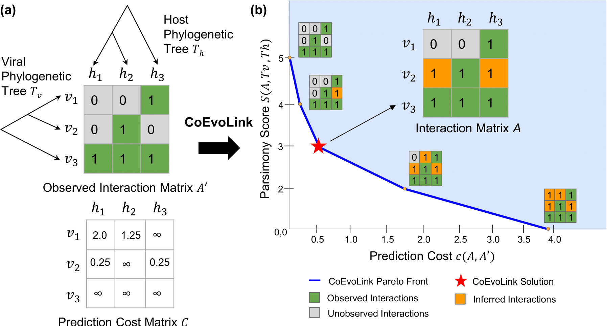

# CoEvoLink : A Cophylogenetic Approach for Viral-Host Interaction Prediction

**(a)** CoEvoLink takes an observed binary interaction matrix *A'* as input, where *a'<sub>i,j</sub>* = 1 indicates a documented virus–host interaction and *a'<sub>i,j</sub>* = 0 denotes either an untested interaction or a true non-interaction. The method infers the true interaction matrix *A* by proposing 0 → 1 flips in *A'*, guided by the viral and host phylogenies (*T<sub>v</sub>* and *T<sub>h</sub>*) and a prediction cost matrix *C*, where *c<sub>i,j</sub>* reflects the likelihood that virus *i* interacts with host *j*. **(b)** CoEvoLink balances parsimony on the phylogenies, *S(A, *T<sub>v</sub>*, *T<sub>h</sub>*)*, against the prediction cost *c(A, A')*. By computing the Pareto front over this trade-off, it selects the most plausible interaction matrix as the elbow point.


## Overview
We introduce a framework for predicting virus–host interactions that integrates sequence-based evidence with cophylogenetic signal by explicitly modeling viral–host coevolution. We infer likely but unobserved interactions by minimizing the number of evolutionary events required to explain them, extending classical maximum parsimony from a single phylogeny to simultaneous parsimony on both host and virus trees. Sequence-based likelihoods are incorporated through interaction costs, creating a natural trade-off between parsimony and prediction cost. Leveraging a connection to maximum parsimony on phylogenetic networks, we derive a polynomial-time algorithm that identifies the optimal balance. The resulting method, CoEvoLink, is efficient, interpretable, and easily integrated with existing sequence-based predictors.

## Installation

### Prerequisites

- Python 3.8+ (tested with Python 3.8-3.12)
- Snakemake (for pipeline execution)
- RevBayes (for Bayesian phylogenetic simulations)
  
### Python Dependencies

The project requires the following Python packages:

```bash
pip install numpy scipy matplotlib biopython networkx pandas kneed
```

Key dependencies:
- `biopython`: Phylogenetic tree manipulation
- `networkx`: Graph algorithms and minimum cut
- `numpy`, `scipy`: Numerical computations
- `matplotlib`: Visualization
- `kneed`: Elbow detection for parameter optimization

**Note**: For reproducible installations, consider creating a virtual environment. A `requirements.txt` file may be added in future releases for version-pinned dependencies.

## CoEvoLink Docker Image

The **CoEvoLink** environment is available as a container on GitHub Container Registry (GHCR).  
This lets you run the full environment without installing Conda, Snakemake, or other dependencies locally.


### Pull the Container

- Make sure Docker is installed on your system.  
- Pull the image with:

```bash
docker pull ghcr.io/princezarzees/myimage:latest
```
### Run the Container Interactively

- Start an interactive terminal session inside the container:
```bash
docker run -it ghcr.io/princezarzees/myimage:latest bash
```
You will drop into a shell with all tools pre-installed.

### Mount Your Project Directory

To give the container access to your local files:

```bash
docker run -it -v $PWD:/workspace ghcr.io/princezarzees/myimage:latest bash
```

Inside the container, your current directory will appear as `/workspace`.
You can now run your workflow or scripts inside the container.


## Usage
- `simulation_utils.py` contains the necessary functionalities for CoEvoLink.
- `parametric_pareto.py` enumerates the Pareto front by parametric maximum flow (see below).

### Enumerating the Pareto front by parametric maximum flow

`parametric_pareto.py` enumerates every Pareto optimal interaction matrix, with the λ interval on which each is optimal, by parametric maximum flow (Theorem 2 and Supplemental Algorithm 2), instead of solving Balanced PIP on a grid of λ values. It returns the same matrices as `solve_network_cut`, and by default selects the elbow from the 50-λ sweep used in the paper. The front, elbow matrix, predictions, plot and a summary are written to `--outdir`.

```bash
# Your own data (rows = viruses, columns = hosts; --costs is optional)
python parametric_pareto.py --matrix A.csv --costs C.csv \
    --host_tree hosts.newick --virus_tree viruses.newick \
    --r01_h 0.5 --r10_h 0.5 --r01_p 0.5 --r10_p 0.5 --outdir out

# One Mk-model simulation instance (add --genomic_costs for genomic-informed costs)
python parametric_pareto.py --simulate --seed 42 --corrupt 1000 --r01 0.1 --r10 0.4 \
    --host_tree my_simulations_bigger_tree/hosts_tree_big.newick \
    --virus_tree my_simulations_bigger_tree/viruses_tree_big.newick \
    --check_grid 50 --outdir parametric_out/seed42
```

### Running Simulations

#### Basic Simulation

```bash
cd my_simulations_bigger_tree
python simulation.py --seed 42 --r01_p 0.5 --r10_p 0.5 --r01_h 0.5 --r10_h 0.5 --corrupt 5000 --host_tree hosts_tree_big.newick --virus_tree viruses_tree_big.newick
```

Parameters:
- `--seed`: Random seed for reproducibility
- `--host_tree`: Newick format host phylogenetic tree
- `--virus_tree`: Newick format virus/parasite phylogenetic tree
- `--corrupt`: Number of interactions to randomly hide
- `--r01_p`, `--r10_p`: Transition rates (0→1, 1→0) for parasites
- `--r01_h`, `--r10_h`: Transition rates for hosts

#### Simulation on Host-Repertoire Model

```bash
cd my_simulations
```
- You first have to run `RevBayes` to simulate the interaction matrix using Braga et al. host repertoire model.
```bash
rb Simulate.Rev --args <seed> <beta> <mu> <outdir>
```
For example,
```bash
rb Simulate.Rev --args 86 1 1 experiments
```
will generate `sim86-b1-c1.nex` (interaction matrix) and `sim86-b1-c1.settings.txt` (parameter values) under `experiments` folder.

Then run CoEvoLink
```bash
python simulation.py --seed 86 --host_tree hosts_tree_big.newick --virus_tree viruses_tree_big.newick --nexus_file experiments/sim86-b1-c1.nex --braga experiments/sim86-b1-c1.settings.txt
```

- Please see the `Snakefile` under `my_simulations` and `my_simulations_bigger_tree` folder for details.

#### Using Snakemake Pipeline

Run the complete simulation analysis pipeline:

```bash
snakemake --cores all
```

This will:
1. Generate simulated host-parasite networks
2. Corrupt interaction matrices
3. Recover interactions using the network cut algorithm
4. Evaluate performance metrics (precision, recall, F1)
5. Generate visualization plots

### Running on Virion
- Run `virion/virion_matrix.ipynb` for reproducing the interaction matrix predicted by CoEvoLink that are missing in the VIRION database.
- Please see `virion/simulation_notebook.ipynb` for details.

### Running on Bacteriophages
- Run `HostPredictionReview/plotting.py` to generate the *top-1/3 accuracy* comparison graph.  
- Run `HostPredictionReview/simulation_wish.py`, `HostPredictionReview/simulation_phist.py` and `HostPredictionReview/simulation_pblks.py` to observe the `top-k` result of integrating CoEvoLink with different methods.

